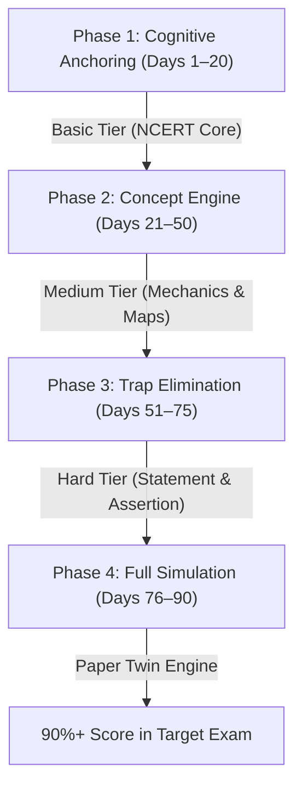

# The Aspirant's Master Manual: Zero-Knowledge to 90%+ Exam Mastery
### *A Complete Step-by-Step Pedagogical Roadmap, Platform Feature Playbook & Strategic FAQ*
**Target Examinations:** UPSC CSE (Prelims & Mains) | BPSC CCE | SSC CGL | RRB NTPC  
**Powered by:** The Tayaari 5,551 NCERT-Grounded Adaptive Question Engine

---

## 🧭 Table of Contents
1. [Executive Philosophy: Why Geography Guarantees the Highest Exam ROI](#1-executive-philosophy)
2. [The 4-Phase Zero-to-Topper Learning Architecture](#2-the-4-phase-zero-to-topper-learning-architecture)
   - Phase 1: Cognitive Anchoring (Days 1–20)
   - Phase 2: Concept Engine & Spatial Synthesis (Days 21–50)
   - Phase 3: Examiner Trap Elimination & Multi-Statement Mastery (Days 51–75)
   - Phase 4: Full Spectrum Paper Twin Simulation (Days 76–90)
3. [Exam-Specific Strategy Blueprints](#3-exam-specific-strategy-blueprints)
   - Track 1: UPSC CSE (Civil Services Prelims & Mains)
   - Track 2: BPSC CCE (State Civil Services & Regional Geography)
   - Track 3: SSC CGL (Tier 1 & Tier 2 High-Speed Precision)
   - Track 4: RRB NTPC (Railway Non-Technical Popular Categories)
4. [Master Feature Guide: How to Extract 100% Value from the Platform](#4-master-feature-guide)
   - The 3-Tier Cognitive Hierarchy (Basic, Medium, Hard)
   - The 5 Canonical Question Formats & Decryption Methods
   - Spaced Repetition (SRS) & The Leitner Daily Queue
   - Memory Anchors (`💡 MEMORY ANCHOR`) Mastery
   - Distractor Dissections & 3-in-1 Learning
   - Expert / Investor Preview Mode: Open-Book Systematic Reading
   - Summit Rush Canvas Gamification
   - Zero-Storage Cloud Sync
5. [The Examiner Trap Playbook: How to Crack UPSC/SSC Questions](#5-the-examiner-trap-playbook)
6. [25+ Comprehensive Aspirant FAQs](#6-25-comprehensive-aspirant-faqs)
7. [Operational Timelines: 30-Day, 60-Day & 90-Day Execution Blueprints](#7-operational-timelines)
8. [Master Chapter-by-Chapter NCERT Concept Checklist](#8-master-chapter-by-chapter-ncert-concept-checklist)

---

## 1. Executive Philosophy

> [!IMPORTANT]
> Geography is not an exercise in memorizing disconnected facts. In modern competitive examinations (UPSC, BPSC, SSC, RRB), Geography is a **first-principles science of spatial cause and effect**.

When an examiner asks about the location of an iron and steel plant, they are testing Alfred Weber's *Least Cost Theory* and the *Material Index*. When they ask why Tamil Nadu receives winter rain, they are testing the *northeast monsoon's moisture pickup over the warm Bay of Bengal* and the *retreating ITCZ*. 

Every question in the Tayaari question bank has been constructed around this principle. With **5,551 verified questions**, **100% NCERT terminology grounding (503/503 audited terms)**, **3 difficulty tiers**, and **full distractor dissections**, a student starting with absolute zero knowledge can methodically build a mental model superior to 99% of competitors.

```
┌────────────────────────────────────────────────────────────────────────┐
│                      THE PEDAGOGICAL PYRAMID                           │
├────────────────────────────────────────────────────────────────────────┤
│  Level 4: Real-Time Exam Simulation (Timed Mocks & Negative Control)   │
│  Level 3: Examiner Trap Dissection (Distractor Immunity & Elimination) │
│  Level 2: Causal Mechanics & Spatial Mapping (Medium Tier Synthesis)   │
│  Level 1: NCERT Core Vocabulary & Concepts (Basic Tier Foundations)    │
└────────────────────────────────────────────────────────────────────────┘
```

---

## 2. The 4-Phase Zero-to-Topper Learning Architecture



### Phase 1: Cognitive Anchoring (Days 1–20)
* **Goal:** Demystify foundational terminology and build a basic mental map of the Earth and India.
* **Target Questions:** **Basic Tier Only** across Topics 1 to 14.
* **Daily Quota:** 40–50 Basic questions per day.
* **The "Zero-Pressure Rule":** If you do not know the answer, **do not guess**. Tap an option immediately to reveal the explanation. Read the explanation completely, pay special attention to the **`💡 MEMORY ANCHOR`**, and let the app's Spaced Repetition System automatically schedule it for future recall.
* **Key Topics Covered:**
  - Topic 1: Universe, Solar System & Earth Motions (Aphelion, Perihelion, Solstice, Equinox)
  - Topic 2: Latitudes, Longitudes & Time (Standard Time, IDL, Great Circles)
  - Topic 4: Earth's Interior & Plate Tectonics (Moho, Gutenberg, P/S waves, Crust-Mantle-Core)
  - Topic 5: Geomorphic Landforms (Karst, Glacial, Fluvial, Arid features)
  - Topic 6: Atmosphere & Winds (Layers, Normal Lapse Rate, Pressure Belts)
  - Topic 9: India Location & Borders (82°30'E, Tropic of Cancer, Channels)
  - Topic 10: Physiography of India (Himadri, Shiwaliks, Bhabar, Terai, Western Ghats)
  - Topic 11: Drainage System of India (Indus, Ganga, Brahmaputra, Peninsular rivers)

### Phase 2: Concept Engine & Spatial Synthesis (Days 21–50)
* **Goal:** Understand the "Why" behind geographic processes and connect physical geography to economic and human geography.
* **Target Questions:** **Medium Tier** across all 23 core chapters.
* **Daily Quota:** 60 Medium questions per day.
* **The "Three-Distractor Deconstruction Rule":** For every question, identify not only why the correct option is right, but why each of the other three options is wrong. Read the *Distractor Dissection* panel.
* **Key Topics Covered:**
  - Topic 7: Oceanography (Currents, Tides, Salinity, Continental margins)
  - Topic 8: Biogeography & Ecosystems (Ecological pyramids, Biomes, Succession)
  - Topic 12: Indian Climate & Monsoon (ITCZ, Jet Streams, ENSO, IOD, Koppen)
  - Topic 13: Soils & Vegetation (ICAR classification, Champion & Seth forest types)
  - Topic 14: Protected Areas (National Parks, Biosphere Reserves, Ramsar sites)
  - Topic 15: Agriculture (Kharif/Rabi, Cropping zones, SRI, Shree Anna)
  - Topic 16: Water Resources (Irrigation systems, Multipurpose dams, Inter-linking)
  - Topic 17 & 18: Minerals & Industries (Weber theory, Steel clusters, Industrial corridors)
  - Topic 19 & 20: Transport & Demography (Ports, Freight corridors, Demographic transition)

### Phase 3: Examiner Trap Elimination & Multi-Statement Mastery (Days 51–75)
* **Goal:** Develop immunity to subtle examiner traps, tricky distractor wordings, and complex multi-statement formats.
* **Target Questions:** **Hard Tier** questions + Statement-Based, Assertion-Reason, and Sequence Ordering formats.
* **Daily Quota:** 50 Hard / Multi-statement questions per day.
* **Methodology:** Utilize the **Investor / Expert Preview Screen** to browse questions by exam format. Filter specifically by *Statement Based* and *Hard Tier*. Practice the **Absolute Word Rule** and **Bilateral Elimination** (detailed in Section 5).
* **Focus Chapters:** Topics 4, 5, 6, 10, 11, 12, 18, and 21.

### Phase 4: Full Spectrum Paper Twin Simulation (Days 76–90)
* **Goal:** Exam-day speed, psychological stamina, and negative marking containment.
* **Target Questions:** Mixed sets under timed pressure.
* **Daily Quota:** Two 50-question mock blocks per day under strict 45-minute countdowns.
* **Negative Marking Protocol:** Target an accuracy rate above 88%. If confidence on a question is below 50% after initial elimination, mark for review and proceed.

---

## 3. Exam-Specific Strategy Blueprints

### Track 1: UPSC CSE (Civil Services Examination — Prelims & Mains)
* **Prelims Core DNA:** Conceptual depth, cause-and-effect teleconnections, multi-statement options (*"Which of the statements given above is/are correct?"*), environmental interlinkages, and recent protected area locations.
* **How to Prepare:**
  1. Complete all Medium and Hard questions in Topics 4, 5, 6, 7, 8, 10, 11, 12, 13, and 14.
  2. Pay special attention to **Köppen climatic codes** (Topic 12), **Ecological Pyramids** (Topic 8), **Plate Boundaries** (Topic 4), and **International maritime straits** (Topic 22).
  3. **Mains Answer Writing Transfer:** Use the question explanations as ready-made 50-word answer templates. The explanations explicitly follow the *Statement -> Mechanism -> Geographic Example -> Memory Anchor* structure required in GS Paper 1.

### Track 2: BPSC CCE (Bihar Combined Competitive Examination)
* **BPSC Core DNA:** Physical and regional geography of India with a heavy, non-negotiable focus on **Bihar Regional Geography (Topic 23)**.
* **How to Prepare:**
  1. Master **Topic 23 (Bihar Geography)** completely — all 62 questions covering the Someshwar Range, North & South Gangetic Plains, Kosi, Gandak, Son, Falgu, Karail-Kewal soils, Tal soils, Balasundar, Valmiki Tiger Reserve, Kanwar Lake Ramsar site, and Amjhor pyrites.
  2. Study peninsular and northern drainage (Topics 10 & 11) with river confluences along the Ganga.
  3. Review agro-climatic regionalization of Bihar (Zones I, II, IIIA, IIIB).

### Track 3: SSC CGL (Tier 1 & Tier 2)
* **SSC Core DNA:** High-speed direct factual recall, physical geography terminology, dams, rivers, mountain peaks, national parks, mineral hubs, and Census 2011 demographic rankings.
* **How to Prepare:**
  1. Focus on **Basic Tier & Direct Fact / Match the Following formats** across Topics 9, 10, 11, 13, 14, 17, 18, 19, and 20.
  2. Memorize the **`💡 MEMORY ANCHOR`** at the bottom of every question. These provide 1-second mental triggers for national highways, highest peaks (Anamudi, Doddabetta, Deomali, Arma Konda), and ports.
  3. Aim for a target pace of **20 to 25 seconds per question**.

### Track 4: RRB NTPC (Railway Non-Technical Categories)
* **RRB Core DNA:** Broad general awareness, railway zones, transport corridors, physical boundaries, climate phenomena, and prominent landmark topography.
* **How to Prepare:**
  1. Master Topic 19 (Transport, Communication & Trade) and Topic 9 (India: Location, Size & Neighbours).
  2. Practice Basic and Medium tiers in physical geography (Topics 1, 2, 4, 5, 6).
  3. Use **Summit Rush** visual game mode to build rapid associative memory of India's physiographic features.

---

## 4. Master Feature Guide

### 1. The 3-Tier Cognitive Hierarchy

```
┌─────────┬──────────────────────────┬────────────────────────────────────────────────────────┐
│ Tier    │ Cognitive Focus          │ When the Aspirant Must Use It                          │
├─────────┼──────────────────────────┼────────────────────────────────────────────────────────┤
│ Basic   │ Factual grounding & terms│ First time studying a topic. Zero prior exposure.      │
│ Medium  │ Mechanism & relationships│ Building conceptual reasoning and spatial correlation. │
│ Hard    │ Subtle traps & synthesis │ Preparing for Prelims elimination and multi-statements.│
└─────────┴──────────────────────────┴────────────────────────────────────────────────────────┘
```
> [!TIP]
> Never jump straight to "Hard" on a newly studied topic. Clear all Basic questions first to lay the neural wiring, then advance to Medium.

---

### 2. The 5 Canonical Question Formats & Decryption Methods

1. **Direct Fact (1,900 questions):**
   - Single question stem, 4 choices.
   - *Decryption:* Read the question stem twice. Watch out for negative qualifiers (*"is NOT"*, *"does NOT"*).
2. **Statement-Based (3,001 questions):**
   - 2 to 4 numbered statements followed by combination options (1 only, 1 and 2, 2 and 3, All of the above).
   - *Decryption:* Treat each statement as an independent True/False question. Cross out eliminated options immediately.
3. **Assertion-Reason (431 questions):**
   - Two propositions: Assertion (A) and Reason (R).
   - *Decryption:* Apply the **"BECAUSE Test"**: Read Assertion (A) $\rightarrow$ Insert the word **BECAUSE** $\rightarrow$ Read Reason (R). If the sentence flows as a valid scientific cause, select Option A.
4. **Match the Following (57 questions):**
   - Two columns (Lists I & II).
   - *Decryption:* Find the single pair you are 100% certain of. Cross-check with option codes to eliminate 50–75% of choices instantly.
5. **Sequence Ordering (162 questions):**
   - Spatial (North to South, West to East) or Chronological sequences.
   - *Decryption:* Anchor the extreme endpoints (e.g. northernmost pass or southernmost river).

---

### 3. Spaced Repetition (SRS) & The Leitner Daily Queue

The app incorporates an automated **Leitner 5-Box Spaced Repetition Engine**:
- **Box 1 (Daily):** Questions answered incorrectly or newly bookmarked.
- **Box 2 (Every 3 Days):** Questions answered correctly once.
- **Box 3 (Every 7 Days):** Questions answered correctly twice consecutively.
- **Box 4 (Every 14 Days):** Strong conceptual memory.
- **Box 5 (Every 30 Days):** Permanent long-term memory.

> [!IMPORTANT]
> **Daily Rule:** Always complete your **Saved / SRS queue** before starting a new chapter. Re-activating decaying memories takes 20% of the effort of re-learning forgotten material.

---

### 4. Memory Anchors (`💡 MEMORY ANCHOR`)

Every question explanation concludes with an uppercase **`💡 MEMORY ANCHOR`**. These are condensed mnemonic devices, comparative formulas, or mental pegs designed by senior examiners:
* *Example (Topic 4):* `MEMORY ANCHOR: Discontinuities Top to Bottom: Conrad (Crust), Moho (Crust-Mantle), Repetti (Mantle), Gutenberg (Mantle-Core), Lehmann (Inner Core) -> Mnemonic: CMRGL.`
* *Example (Topic 10):* `MEMORY ANCHOR: South to North Channels: 8 (Maldives-Minicoy), 9 (Minicoy-Lakshadweep), 10 (Andaman-Nicobar).`
* *How to use:* Keep a dedicated 100-page notebook. Write down only the Memory Anchors. Review 20 pages every Sunday.

---

### 5. Distractor Dissections & 3-in-1 Learning

Each question contains detailed distractor dissections explaining why wrong options are wrong:
- **Trap Type: Geographic Swap:** (e.g. stating that Mahendragiri is in the Western Ghats when it is in the Eastern Ghats).
- **Trap Type: Absolute Overgeneralization:** (e.g. stating that tropical cyclones *always* form over land).
- **Trap Type: Temporal / Chronological Reversal:** (e.g. confusing Pleistocene Karewa deposits with Gondwana coal).
By reading the distractor dissections, **you learn 4 geographic facts per question rather than 1**. Across 5,551 questions, you master over 22,000 distinct geographic data points.

---

### 6. Expert / Investor Preview Mode (Bottom Nav 🏆)

The **Investor / Expert Preview Screen** is accessible via the "Preview" button in the bottom navigation bar:
- **Chapter Sidebar:** Shows exact question counts across all 30 topics.
- **Exam Filters:** Filter live questions for `All Exams`, `UPSC CSE`, `BPSC CCE`, `SSC CGL`, or `RRB NTPC`.
- **Tier Toggles:** Switch between Basic, Medium, and Hard.
- **Instant Reveal Toggle:** View stems, options, correct answers, and full distractor analyses in an open-book reading mode.
- *Best Use Case:* Use on weekends for rapid, distraction-free syllabus survey.

---

### 7. Summit Rush & Canvas Gamification

Summit Rush turns geographic contour traversal and mountain climbing into a visual interactive drill. 
- *Best Use Case:* During periods of low mental energy (afternoons or late evenings), play 15 minutes of Summit Rush to maintain cognitive momentum without burnout.

---

### 8. Zero-Storage Cloud Sync

The app downloads manifest files and topic slices over the air on demand:
- Uses volatile in-memory caching to keep SQLite storage at zero bytes.
- Automatic cache-busting ensures you always practice the latest verified questions.
- If you lose internet connection after loading a topic, the current slice remains accessible in RAM until the session is closed.

---

## 5. The Examiner Trap Playbook

Experienced UPSC and State PCS question authors rely on specific psychological and cognitive tricks:

| Trap Technique | Examiner M.O. | Counter-Strategy |
| :--- | :--- | :--- |
| **The "Absolute Trap"** | Uses words like *only, never, all, completely, solely, exclusively*. | In geography, absolute statements are almost always false because nature exhibits local exceptions. Treat absolute words with 90% suspicion. |
| **The "Bilateral Swap"** | Swaps attributes of two similar entities (e.g. swaps Bhangar and Khadar; or swaps Western Ghats and Eastern Ghats characteristics). | Isolate the paired terms and check whether reversing their definitions makes the sentence true. |
| **The "Right Fact, Wrong Reason"** | In Assertion-Reason, both statements are independently true facts, but Reason (R) does not explain Assertion (A). | Always read the two statements with the word **"BECAUSE"** placed between them. |
| **The "False Negative"** | Hides *"NOT correct"* or *"INCORRECT"* inside a long, verbose prompt. | Underline or circle the word **NOT** or **INCORRECT** before evaluating any options. |

---

## 6. 25+ Comprehensive Aspirant FAQs

### General Background & Starting Out
#### Q1: I have zero science or geography background. Can I realistically score 90%+ using this app?
**A:** Yes. Geography is the most logical and structured of all General Studies disciplines. Because every question in this app is tiered (Basic $\rightarrow$ Medium $\rightarrow$ Hard) and grounded in NCERT concepts, you are never asked to solve complex problems without first learning the basic definitions. Follow the 4-phase architecture in Section 2.

#### Q2: How many questions should I practice per day?
**A:** Quality and retention matter far more than raw volume:
- **Beginners (Weeks 1–3):** 40–50 Basic questions/day + 15 minutes reviewing explanations.
- **Intermediate (Weeks 4–8):** 60 Medium questions/day + daily SRS queue.
- **Advanced / Pre-Exam (Weeks 9–12):** 75–100 mixed questions/day + full mock tests.

#### Q3: Should I read standard theory textbooks (NCERTs / GC Leong) before or after practicing?
**A:** Use the **"Sandwich Technique"**:
1. Read the corresponding NCERT chapter quickly (1 hour) to familiarize yourself with the vocabulary.
2. Immediately open the matching topic in the app and practice the **Basic Tier** questions.
3. Review the explanations and **`💡 MEMORY ANCHOR`**s for any questions missed.
4. Return to the textbook — you will now notice the exact lines, boxes, and diagrams from which examiners author questions.

---

### Platform Features & Learning Retention
#### Q4: What should I do if my accuracy in a topic drops below 60%?
**A:** A drop below 60% indicates a conceptual gap, not an aptitude failure. Stop testing immediately. Switch the filter in that topic back to **Basic Tier**, turn on **Investor Preview Mode**, and read through the first 30 questions in open-book mode with explanations revealed. Re-test on Medium Tier the following day.

#### Q5: How does the Spaced Repetition (SRS) queue prioritize questions?
**A:** The app uses a modified Leitner algorithm. If you answer a question correctly, its interval increases (1 day $\rightarrow$ 3 days $\rightarrow$ 7 days $\rightarrow$ 14 days $\rightarrow$ 30 days). If you answer incorrectly, it immediately resets to Box 1 (daily review).

#### Q6: Can I use the app offline?
**A:** Once a topic slice is loaded into volatile memory over Wi-Fi or mobile data, you can practice all questions within that topic session even if your connection drops. To load a new topic, a brief internet connection is required to stream the slice from the cloud CDN.

#### Q7: What is the difference between "Practice Screen" and "Investor Preview Screen"?
**A:** 
- **Practice Screen:** Interactive testing mode with hidden answers, immediate red/green feedback, streak counters, and SRS integration.
- **Investor Preview Screen:** Open-book inspection mode accessible from the bottom navigation bar. It allows chapter-by-chapter browsing, exam category filtering (`UPSC_CSE`, `BPSC_CCE`, `SSC_CGL`, `RRB_NTPC`), and instant explanation reveals.

---

### Content, Exams & Syllabus Specifics
#### Q8: How is Bihar Geography (Topic 23) structured for BPSC aspirants?
**A:** Topic 23 contains 62 questions authored for the BPSC CCE syllabus. It covers the Someshwar range and Dun valley, North and South Gangetic plains, the complete river network (Kosi, Gandak, Son, Falgu, Punpun, Karmanasa), soil taxonomy (Karail-Kewal, Tal, Balasundar, Terai), protected areas (Valmiki Tiger Reserve, Kanwar Lake Ramsar site, Vikramshila), and mineral deposits (Amjhor pyrites, Rohtas limestone).

#### Q9: How does the question bank handle conflicting facts between state boards and NCERT?
**A:** For national exams (UPSC, SSC, RRB), the Union Public Service Commission and Staff Selection Commission treat **NCERT textbooks and Survey of India official data as the definitive ground truth**. In instances of divergence, our explanations explicitly highlight the NCERT standard and provide the state board variation in the distractor dissection.

#### Q10: Does practicing these MCQs help with UPSC Mains answer writing?
**A:** Yes. In UPSC Mains (GS Paper 1), high-scoring answers require concise definitions, causal mechanisms, spatial examples, and schematic diagrams. The **`💡 MEMORY ANCHOR`** and conceptual summaries in our explanations provide pre-formatted 50-word building blocks for 10-marker and 15-marker Mains questions.

---

### Exam Strategy & Psychology
#### Q11: How do I overcome the fear of negative marking?
**A:** Negative marking (-0.66 in UPSC, -0.33 in BPSC, -0.50 in SSC) punishes blind guessing, but rewards **calculated elimination**:
- If you can eliminate 2 out of 4 options, the mathematical expected value of attempting the question is positive (+0.33 marks in UPSC).
- Practice the **Bilateral Elimination Method** (Section 5) in Phase 3 until eliminating 2 options becomes second nature.

#### Q12: How should I pace myself during the final 15 days before the preliminary exam?
**A:** In the final 15 days:
1. Stop learning completely new optional chapters.
2. Clear your **SRS Saved Queue** daily.
3. Review your notebook of **`💡 MEMORY ANCHOR`**s.
4. Practice 30 map-based questions daily (tributaries, mountain passes, national parks, straits).

---

## 7. Operational Timelines

### 30-Day Crash / Revision Sprint (For Aspirants with 1 Month Left)
* **Week 1:** Topics 1, 2, 4, 5, 6, 7 (Physical Geography Foundation — 50 Medium questions/day).
* **Week 2:** Topics 9, 10, 11, 12, 13 (Indian Physiography, Drainage, Monsoon & Soils — 60 Medium/Hard questions/day).
* **Week 3:** Topics 14, 15, 16, 17, 18, 19, 20 (Resources, Agriculture, Industries, Ports — 60 questions/day).
* **Week 4:** Full mock simulations + 100% review of Bookmarked / SRS questions + Memory Anchors only.

### 60-Day Standard Sprint (For Serious Focused Aspirants)
* **Days 1–15:** Complete all Basic Tier questions across Topics 1 to 14.
* **Days 16–35:** Complete all Medium Tier questions across Topics 1 to 23.
* **Days 36–50:** Complete Hard Tier + Statement-based questions using Investor Preview Mode.
* **Days 51–60:** Daily Paper Twin Mock sets under strict negative marking conditions.

### 90-Day Zero-to-Topper Blueprint (Comprehensive Mastery)
* **Phase 1 (Days 1–20):** Cognitive Anchoring (Basic Tier only, Topics 1–14).
* **Phase 2 (Days 21–50):** Concept Engine & Spatial Synthesis (Medium Tier, Topics 1–23 + Map drills).
* **Phase 3 (Days 51–75):** Trap Elimination & Advanced Synthesis (Hard Tier + Statement-Based/Assertion-Reason).
* **Phase 4 (Days 76–90):** Full Exam Simulation, Speed Tuning, and Memory Anchor consolidation.

---

## 8. Master Chapter-by-Chapter NCERT Concept Checklist

Check off each core concept as you master it in the app:

- [ ] **Topic 1 (Universe & Motions):** Nebular hypothesis, Singularity, Planetesimals, Aphelion, Perihelion, Summer/Winter Solstice, Equinox, Circle of Illumination, Coriolis force, Sidereal vs Solar day.
- [ ] **Topic 2 (Globe & Coordinates):** Great circles, Antipodal coordinates, Prime Meridian, International Date Line, Rhumb line / Loxodrome, Local vs Standard time.
- [ ] **Topic 3 (Maps & GIS):** Representative Fraction (RF), Contour intervals, Cylindrical Mercator, Conical, Zenithal/Azimuthal projections, Remote sensing spectral bands, DEM/GIS.
- [ ] **Topic 4 (Interior & Tectonics):** Conrad, Moho, Repetti, Gutenberg, Lehmann discontinuities; P/S wave shadow zones; Paleomagnetism; Seafloor spreading; Benioff zone; Batholith, Laccolith, Lopolith, Phacolith, Sill, Dyke.
- [ ] **Topic 5 (Geomorphology):** Diastrophism, Orogenic vs Epeirogenic, Exfoliation, Solifluction, Peneplain vs Pediplain, Karst features (stalactites, poljes, uvalas), Glacial (cirque, horn, drumlins, eskers), Arid (barchans, yardangs, zeugen, pediments).
- [ ] **Topic 6 (Atmosphere & Climate):** Solar constant ($1.94\text{ cal/cm}^2\text{/min}$), Albedo, Normal lapse rate ($6.5^\circ\text{C/km}$), Temperature inversion, Hadley/Ferrel/Polar cells, ITCZ, Rossby waves, Jet streams, Foehn/Chinook/Sirocco/Mistral, Frontogenesis vs Frontolysis, Extra-tropical vs Tropical cyclones.
- [ ] **Topic 7 (Oceanography):** Continental shelf, Continental slope, Continental rise (turbidites), Abyssal plain, Guyots, Mid-oceanic ridge, Thermocline, Isohalines, Spring and Neap tides (Syzygy vs Quadrature), Major ocean currents (Kuroshio, Gulf Stream, Benguela, Humboldt, Somali upwelling).
- [ ] **Topic 8 (Biogeography):** Biomes, 10% energy transfer law, Ecological pyramids (upright vs inverted biomass), Hydrarch and Xerarch succession, Pioneer and Climax communities, Alpha/Beta/Gamma diversity, Norman Myers hotspot criteria.
- [ ] **Topic 9 (India Location):** 82°30'E Standard Meridian, Tropic of Cancer 8 states, Radcliffe/McMahon/Durand lines, 10°/9°/8° Channels, Duncan Passage, Great Channel, Coco Channel, Ghuar Mota and Kibithu endpoints.
- [ ] **Topic 10 (Physiography of India):** Himadri, Himachal, Shiwaliks; Bhabar, Terai, Bhangar, Khadar; Karewas; Duns and Duars; Malda Fault (Garo-Rajmahal Gap); Western Ghats passes (Thal, Bhor, Palghat, Shencottah); Anamudi, Doddabetta, Barren Island.
- [ ] **Topic 11 (Drainage of India):** Superimposed vs Antecedent drainage; Dendritic, Trellis, Radial, Centripetal patterns; Indus tributaries; Panch Prayags (Vishnuprayag to Devprayag); Narmada and Tapi rift valleys; Godavari, Krishna, Kaveri, Mahanadi.
- [ ] **Topic 12 (Monsoon & Climate):** Tropical Easterly Jet, Somali Jet, Tibetan heating, ENSO, SOI, Indian Ocean Dipole (IOD), MJO, Western Disturbances, Kalbaisakhi, Mango showers, Köppen classes (Amw, As, Aw, Cwg, Dfc, BShw, BWhw).
- [ ] **Topic 13 (Soils & Vegetation):** ICAR 8 soil orders (Inceptisols, Entisols, Vertisols, Alfisols), Regur self-ploughing, Laterite leaching, Champion & Seth forest classification (Tropical wet evergreen, moist/dry deciduous, thorn, montane sholas, mangroves with pneumatophores and vivipary).
- [ ] **Topic 14 (Wildlife & Conservation):** Biosphere Reserves (18 national, 12 UNESCO WNBR), National Parks vs Sanctuaries, Community Reserves, Ramsar sites, Montreux Record, Project Tiger, Project Elephant.
- [ ] **Topic 15 (Agriculture):** Kharif/Rabi/Zaid, Intensive subsistence, Shifting cultivation (Jhum), SRI, Direct Seeded Rice (DSR), Millets / Shree Anna, Weaver crop combination regions.
- [ ] **Topic 16 (Water Resources):** Central Ground Water Board assessment units, Watershed management (Haryali, Neeru-Meeru, Arvari Pani Sansad), National Waterways (NW-1 to NW-5), National River Inter-linking (Ken-Betwa link).
- [ ] **Topic 17 (Minerals & Energy):** Haematite and Magnetite belts (Bailadila, Kudremukh, Mayurbhanj), Bauxite (Panchpatmali), Copper (Malanjkhand, Khetri), Gondwana vs Tertiary coal, Mumbai High, Monazite thorium sands, Amjhor pyrites.
- [ ] **Topic 18 (Industries):** Alfred Weber least-cost theory (Material Index), Footloose industries, Integrated steel plants (TISCO, IISCO, Bhilai, Rourkela, Durgapur, Bokaro), Sugar industry migration to peninsular South, DMIC and Industrial Corridors.
- [ ] **Topic 19 (Transport & Trade):** Golden Quadrilateral, North-South and East-West corridors, Bharatmala, Dedicated Freight Corridors (EDFC & WDFC), 12 Major Ports (including Syama Prasad Mookerjee Port, JNPT, Deendayal).
- [ ] **Topic 20 (Population & Settlements):** Frank Notestein Demographic Transition Theory, Census 2011 metrics, Clustered, Semi-clustered, Hamleted (dhani, panna, para), and Dispersed settlements, Conurbations, Primate cities.
- [ ] **Topic 21 (Human Development):** Mahbub ul Haq and Amartya Sen capability paradigms, HDI dimensions, Primary, Secondary, Tertiary, Quaternary, and Quinary activities, W.W. Rostow's stages of economic growth.
- [ ] **Topic 22 (World Regional Geography):** Chokepoints (Strait of Malacca, Strait of Hormuz, Bab-el-Mandeb, Dover Strait, Gibraltar, Suez, Panama), East African Rift Valley, Ring of Fire, Mariana Trench.
- [ ] **Topic 23 (Bihar Geography):** Someshwar range, Dun valley, North and South Bihar plains, Kosi, Gandak, Son, Falgu, Karail-Kewal and Tal soils, Valmiki Tiger Reserve, Kanwar Lake, Amjhor pyrites, Barauni refinery.
